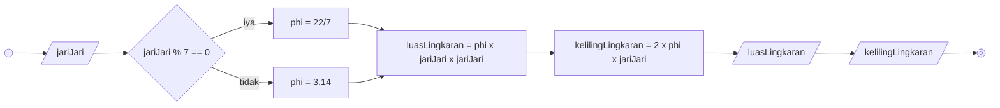

## Membuat algoritma menghitung luas dan keliling lingkaran

### Deskriptif

1. Mulai
2. Input/masukkan jari-jari lingkaran yang ingin dihitung
3. Jika jari-jari lingkaran merupakan kelipatan 7
4. maka phi (π) sama dengan 22/7
5. Hitung luas lingkaran dengan rumus 22/7 dikali jari-jari dikali jari-jari
6. Hitung keliling lingkaran dengan rumus 2 dikali 22/7 dikali jari-jari
7. Tampilkan hasil luas Lingkaran
8. Tampilkan keliling lingkaran
9. Jika jari-jari lingkaran bukan merupakan kelipatan 7
10. maka phi (π) sama dengan 3.14
11. Hitung luas lingkaran dengan rumus 3.14 dikali jari-jari dikali jari-jari
12. Hitung keliling lingkaran dengan rumus 2 dikali 3.14 dikali jari-jari
13. Tampilkan hasil luas lingkaran
14. Tampilkan keliling lingkaran
15. Selesai

### Flowchart



### Pseudocode

```
DECLARE jariJari : INTEGER
DECLARE phi : REAL
DECLARE luasLingkaran : REAL
DECLARE kelilingLingkaran : REAL

INPUT jariJari

IF jariJari MOD 7 = 0 THEN
  phi <- 22/7
ELSE
  phi <- 3.14
ENDIF

luasLingkaran <- phi * jariJari * jariJari
kelilingLingkaran <- 2 * phi * jariJari

OUTPUT luasLingkaran
OUTPUT kelilingLingkaran
```
